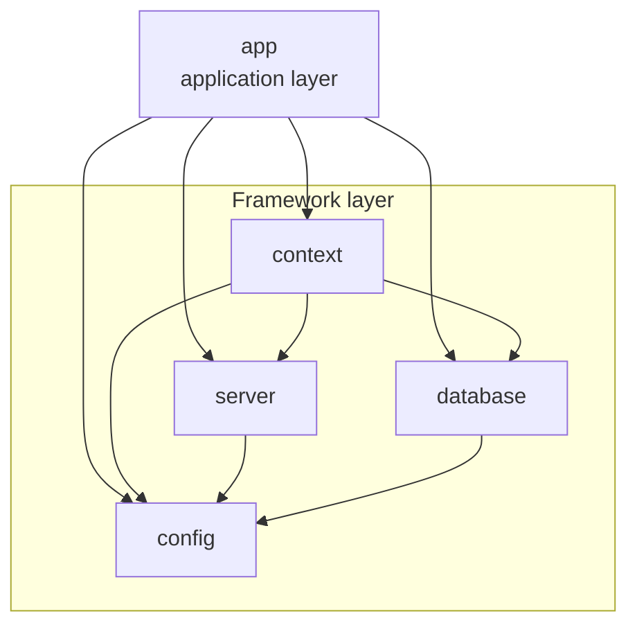

# Fleet Management

> **In short:** A Java 21 fleet-management backend built as a modular monolith with embedded Tomcat, Jersey, Guice, Hibernate, and PostgreSQL.
>
> **Start here:** [Quick start](#quick-start) · [Framework](docs/FRAMEWORK.md) · [Application](docs/APPLICATION.md)

## Documentation

| Layer | Document | Contents |
| --- | --- | --- |
| Framework | [docs/FRAMEWORK.md](docs/FRAMEWORK.md) | Technical modules, contracts, startup, DI, persistence, extension points |
| Framework | [docs/CONFIGURATION.md](docs/CONFIGURATION.md) | Configuration source, property ownership (general, database connection, Hibernate), type parsing |
| Application | [docs/APPLICATION.md](docs/APPLICATION.md) | Implementation model for features, entities, services, repositories, and REST resources |
| Application | [docs/API.md](docs/API.md) | HTTP conventions, resource patterns, errors, pagination, and versioning |
| Development | [docs/DEVELOPMENT.md](docs/DEVELOPMENT.md) | Build, run, IDE setup, conventions, testing |

---

Backend application for fleet management, written in Java 21 and organized as a Maven multi-module project.

The application runs on an embedded Apache Tomcat server, exposes a JAX-RS (Jersey) REST layer, uses Google Guice for dependency injection, and persists data with Hibernate / JPA on PostgreSQL. PostgreSQL and Hibernate are the **default implementations** of the `Database` and `ORM` contracts; both can be replaced by binding the same contracts to different implementations.

## Overview

Fleet Management is split into two layers:

| Layer | Modules | Change profile |
| --- | --- | --- |
| Framework | `config`, `database`, `server`, `context` | Stable technical infrastructure and contracts |
| Application | `app` | Fleet-management features, REST resources, and entities; evolves frequently |

The framework provides configuration, persistence, and HTTP hosting behind contracts. It ships with **PostgreSQL** and **Hibernate** as the default `Database` and `ORM` implementations; the application composes those contracts into fleet-management features.

Detailed framework documentation: [docs/FRAMEWORK.md](docs/FRAMEWORK.md).  
Detailed application documentation: [docs/APPLICATION.md](docs/APPLICATION.md).

---

## Technology stack

| Technology | Role |
| --- | --- |
| Java 21 | Language and runtime |
| Maven | Build and module management |
| Apache Tomcat (embedded) | Servlet container |
| Jersey (JAX-RS) | REST layer |
| Google Guice | Dependency injection |
| HK2 Guice Bridge | Jersey ↔ Guice integration |
| Hibernate ORM | Persistence (default `ORM` implementation) |
| Jakarta Persistence | JPA API used by the ORM layer |
| PostgreSQL JDBC Driver | Database driver (default `Database` implementation) |
| Jackson | JSON serialization |
| SLF4J + Logback | Logging |
| Lombok | Boilerplate reduction |
| JUnit Jupiter | Testing |

PostgreSQL and Hibernate are defaults, not hard-coded dependencies. Exact versions are declared in the parent [`pom.xml`](pom.xml).

---

## Architecture at a glance



| Module | Layer | Responsibility |
| --- | --- | --- |
| `config` | Framework | `Configuration` contract; loads and typed-reads `application.properties` |
| `database` | Framework | `Database` and `ORM` contracts, `BaseRepository`, PostgreSQL and Hibernate implementations |
| `server` | Framework | `Server` contract; embedded Tomcat, Jersey servlet, Guice/HK2 bridge |
| `context` | Framework | `ApplicationContext`, the composition root for framework modules |
| `app` | Application | Entry point, feature modules, JAX-RS resources, domain model, JPA entities |

Framework modules are documented in [docs/FRAMEWORK.md](docs/FRAMEWORK.md). The application layer is documented in [docs/APPLICATION.md](docs/APPLICATION.md).

---

## Requirements

- JDK 21
- Maven 3.9 or newer
- PostgreSQL reachable at the configured host and port
- Optional: IntelliJ IDEA (the project is configured for it)

The default connection settings and all runtime properties are defined in [`config/src/main/resources/application.properties`](config/src/main/resources/application.properties).

---

## Quick start

### 1. Prepare the database

Make sure PostgreSQL is running and that the database and credentials match the configuration in `config/src/main/resources/application.properties`.

See [docs/CONFIGURATION.md](docs/CONFIGURATION.md) for the property reference.

### 2. Build

```bash
mvn clean package
```

The build produces one library JAR per module under each module's `target/` directory. The application is started through the `com.onix322.App` main class.

### 3. Run

The entry point is `com.onix322.App`.

**From IntelliJ IDEA** (the verified workflow):

1. Open the project as a Maven project.
2. Make sure the project SDK is JDK 21 and annotation processing is enabled.
3. Run the `main` method in `app/src/main/java/com/onix322/App.java`.

**From the command line:**

```bash
mvn -DskipTests install
mvn -pl app exec:java -Dexec.mainClass=com.onix322.App
```

The second command uses the Maven Exec plugin, which Maven resolves from the configured repositories.

### 4. Verify

```bash
curl -i http://localhost:8080/
```

See [docs/API.md](docs/API.md) for HTTP conventions and endpoint testing examples.

The application listens on port `8080` by default and blocks the main thread on the Tomcat `await()` loop.

---

## Configuration

Configuration is loaded from `config/src/main/resources/application.properties` at startup.

The complete property reference, supported types, and Guice binding behavior are documented in [docs/CONFIGURATION.md](docs/CONFIGURATION.md). The source of truth for values is the properties file itself.

[docs/CONFIGURATION.md](docs/CONFIGURATION.md) separates the general properties from the implementation-specific ones: `server.*` (server and Jersey) and `database.url`, `database.user`, `database.password` (generic database connection) are independent of any particular database or ORM, while `hibernate.*` belongs to the default Hibernate implementation.

---

## API

HTTP conventions and endpoint patterns are documented in [docs/API.md](docs/API.md).

The application exposes REST resources from the `app` module. Adding or changing an endpoint is an application-layer change; see [docs/APPLICATION.md](docs/APPLICATION.md).
