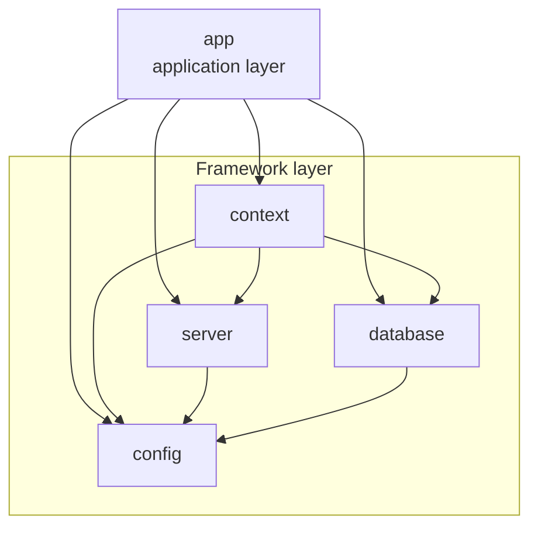
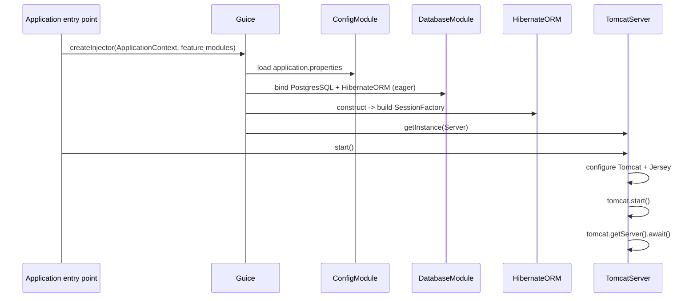
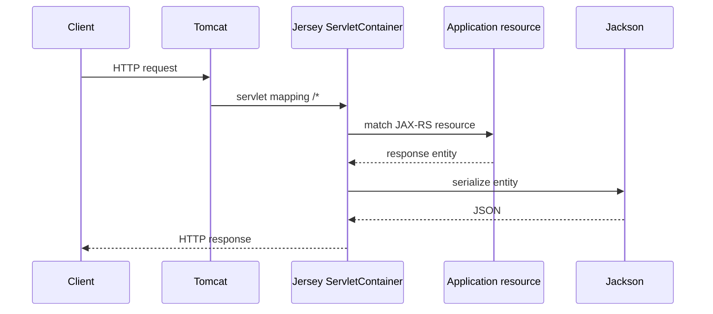

# Framework

> **In short:** The stable technical layer of Fleet Management: configuration, database, embedded server, and composition root.
>
> **Read this if:** you are working on infrastructure, reviewing the platform design, or replacing a technical implementation.
>
> **Related:** [README](../README.md) · [Application](APPLICATION.md) · [Configuration](CONFIGURATION.md) · [Development](DEVELOPMENT.md)

This document covers the **framework layer**. The fleet-management business code lives in the `app` module and is documented separately in [APPLICATION.md](APPLICATION.md).

---

## 1. Scope and design style

The framework is a set of Maven modules that provide technical capabilities to the application:

| Module | Role |
| --- | --- |
| `config` | Loads and exposes application properties |
| `database` | `Database` / `ORM` contracts, generic `BaseRepository`, PostgreSQL and Hibernate default implementations |
| `server` | Embedded Tomcat, Jersey servlet, Guice/HK2 bridge |
| `context` | Composition root for the framework modules |

Design principles:

- modular monolith with build-time module boundaries;
- every technical capability is defined by a contract;
- concrete implementations are selected through Guice bindings;
- the application layer depends on contracts, not on implementation classes;
- configuration is externalized in a classpath properties file.

The framework is intentionally stable. Business features, REST resources, and entities belong to the application layer.

---

## 2. Module graph



| Module | Depends on | Responsibility |
| --- | --- | --- |
| `config` | — | Property loading and typed access |
| `database` | `config` | PostgreSQL, Hibernate, transactions, entity registration |
| `server` | `config` | Embedded Tomcat, Jersey, Guice/HK2 bridge |
| `context` | `config`, `database`, `server` | Framework composition root |
| `app` | `context`, `database`, `server`, `config` | Application layer (see [APPLICATION.md](APPLICATION.md)) |

The parent POM (`com.onix322:fleet:1.0-SNAPSHOT`, packaging `pom`) declares the shared dependency versions and the Java 21 compiler configuration.

---

## 3. Contracts

The framework exposes four contracts:

| Contract | Package | Current implementation | Purpose |
| --- | --- | --- | --- |
| `Configuration` | `com.onix322.config` | `ConfigurationImpl` | Typed access to properties |
| `Database` | `com.onix322.database` | `PostgresSQL` | `DataSource` |
| `ORM` | `com.onix322.database` | `HibernateORM` | Transactional `EntityManager` access |
| `Server` | `com.onix322.server` | `TomcatServer` | HTTP server lifecycle |

Each contract is bound to its implementation in a Guice module. Replacing an implementation means providing a new class and changing the binding; the application layer does not need to change.

The framework ships with **PostgreSQL** (`PostgresSQL`) and **Hibernate** (`HibernateORM`) as the default implementations of `Database` and `ORM`. These are defaults selected through the contracts, not hard-coded dependencies. To replace them, change the bindings in `DatabaseModule`.

`ConfigurationLoader`, `PropertyParser`, and `ApplicationContext` are supporting framework classes rather than public contracts.

---

## 4. `config` module

Package: `com.onix322.config`

```text
Configuration
├── getProperty(String key, Class<T> type)
└── getProperties(String key)

ConfigurationImpl
ConfigurationLoader
PropertyParser
ConfigModule
```

### ConfigurationLoader

- Reads a classpath resource, `application.properties` by default.
- Stores the result in a `java.util.Properties` instance.
- `loadProperties()` delegates to `loadProperties("application.properties")`.
- `loadProperties(String from)` fails with `IllegalStateException` if the resource is absent.
- `getRawProperty(String key)` returns the raw `String` value, or `null`.
- `getProperties()` returns the complete `Properties` object.

### PropertyParser

Converts raw strings to the requested Java type:

| Type | Behavior |
| --- | --- |
| `String` | Trimmed value; blank strings are returned as `""` |
| `Integer` | `Integer.valueOf` |
| `Long` | `Long.valueOf` |
| `Boolean` | Accepts `true` / `false` case-insensitively; other values throw `IllegalArgumentException` |
| `Double` | `Double.valueOf` |

A `null` property, or a blank property requested as a non-`String` type, produces `null`. Any other target type throws `IllegalArgumentException`.

### ConfigurationImpl

- Injected with `ConfigurationLoader` and `PropertyParser`.
- `getProperty` loads the raw value and delegates parsing.
- `getProperties` returns the complete loaded property set. The `key` argument is not used for filtering.

### ConfigModule

```java
ConfigurationLoader loader = new ConfigurationLoader();
loader.loadProperties();
Names.bindProperties(binder(), loader.getProperties());

bind(ConfigurationLoader.class).toInstance(loader);
bind(Configuration.class).to(ConfigurationImpl.class);
```

Effects:

1. `application.properties` is loaded once during injector creation.
2. Every property is bound as a Guice named constant with its raw string value.
3. The same `ConfigurationLoader` instance is available for injection.
4. `Configuration` resolves to `ConfigurationImpl`, which is annotated `@Singleton`.

Full property reference: [CONFIGURATION.md](CONFIGURATION.md).

---

## 5. `database` module

Package: `com.onix322.database`

```text
Database
└── DataSource getDataSource()

ORM
├── <R> R executeWithResult(Function<EntityManager, R> action)
├── void execute(Consumer<EntityManager> action)
└── void close()

PostgresSQL
HibernateORM
BaseRepository<T, ID>
DatabaseModule
```

### Database and PostgresSQL

`PostgresSQL` reads `database.url`, `database.user` and `database.password` through `Configuration`. `getDataSource()` creates a `PGSimpleDataSource` with the configured URL, user and password.

These three keys are general connection properties: any `Database` implementation can read them and map them to its own driver. PostgreSQL is simply the default implementation.

`Database` is a contract that exposes only the `DataSource`. `PostgresSQL` is the current implementation, and another database can be plugged in by binding `Database` to a different implementation in `DatabaseModule`.

### ORM and HibernateORM

`HibernateORM` is responsible for the Hibernate `SessionFactory`. It is constructed with:

- `Database` — provides the `DataSource`;
- `Configuration` — provides Hibernate settings, including the dialect;
- `Set<Class<?>> entities` — the entity classes to register.

The `SessionFactory` is built in the constructor:

```java
settings.put(AvailableSettings.JAKARTA_NON_JTA_DATASOURCE, database.getDataSource());
settings.put(AvailableSettings.DIALECT, configuration.getProperty("hibernate.dialect", String.class));
settings.put(AvailableSettings.HBM2DDL_AUTO, configuration.getProperty("hibernate.hbm2ddl.auto", String.class));
settings.put(AvailableSettings.SHOW_SQL, configuration.getProperty("hibernate.show_sql", Boolean.class));
settings.put(AvailableSettings.FORMAT_SQL, configuration.getProperty("hibernate.format_sql", Boolean.class));

entities.forEach(hibernateConfig::addAnnotatedClass);
```

`ORM` is a contract: `HibernateORM` is the current implementation, and a different persistence provider can be used by binding `ORM` to another implementation in `DatabaseModule`.

Transaction helpers:

- `executeWithResult(Function<EntityManager, R>)` → `SessionFactory.fromTransaction(...)`;
- `execute(Consumer<EntityManager>)` → `SessionFactory.inTransaction(...)`.

Both open a session, begin a transaction, run the callback, commit on success and roll back on failure, then close the session. Hibernate's `Session` implements `EntityManager`, so callbacks can use the standard JPA API.

`close()` closes the `SessionFactory` if it is still open. It is part of the contract and is not invoked automatically by the server lifecycle.

### BaseRepository

Package: `com.onix322.database.repository`

`BaseRepository<T, ID>` is an abstract convenience class built on the `ORM` contract. It is not a contract itself; it gives feature repositories a small, reusable CRUD base without enlarging `ORM`.

| Method | Behavior |
| --- | --- |
| `Optional<T> find(ID id)` | `EntityManager.find` |
| `List<T> findAll()` | Criteria query over the entity type |
| `T save(T entity)` | `EntityManager.persist` (insert) |
| `T update(T entity)` | `EntityManager.merge` (update/upsert) |
| `void delete(T entity)` | `EntityManager.remove`, merging a detached entity first |
| `long count()` | Criteria count query |
| `boolean exists(ID id)` | `EntityManager.find` and null check |

Each method delegates to `execute` or `executeWithResult`, so every call is its own transaction. `save` and `update` are intentionally separate: `save` inserts, `update` merges. Feature repositories extend the class, pass their entity type to the constructor, and add feature-specific queries through `ORM`.

`BaseRepository` receives `ORM` through field injection into a `protected` non-final field. Subclasses therefore only pass the entity type:

```java
import jakarta.inject.Singleton;

@Singleton
public class ExampleRepository extends BaseRepository<ExampleEntity, UUID> {

    public ExampleRepository() {
        super(ExampleEntity.class);
    }
}
```

`@Singleton` is `jakarta.inject.Singleton`. A no-arg constructor is enough for Guice; no explicit binding is required.

The trade-off is that `ORM` is no longer `final` and direct unit tests need Guice or reflection to populate it. Constructor injection remains an option for repositories that prefer explicit dependencies.

Because the class lives in the `database` module, the `app` module can use it through its existing dependency on `database`.

**Recommendation:** extend `BaseRepository` for standard CRUD. When a use case needs more control — explicit queries, locking, flush timing, batch operations, or direct session semantics — use `ORM` directly. The two approaches can be combined in the same repository class: every `BaseRepository` method is just an `ORM` transaction, so mixing inherited CRUD with custom `orm.execute(...)` calls is safe.

### Entity registration

Entities are collected through a Guice multibinding of `Class<?>`:

```java
Multibinder.newSetBinder(binder(), new TypeLiteral<Class<?>>() {});
```

`DatabaseModule` creates the empty set. Feature modules in the application layer add their entity classes. `HibernateORM` injects the resulting `Set<Class<?>>` and registers every element with `addAnnotatedClass`.

### DatabaseModule

```java
bind(Database.class).to(PostgresSQL.class).asEagerSingleton();
bind(ORM.class).to(HibernateORM.class).asEagerSingleton();

Multibinder.newSetBinder(binder(), new TypeLiteral<Class<?>>() {});
```

Both bindings are eager singletons, so the `SessionFactory` is created during injector creation, before Tomcat starts.

---

## 6. `server` module

Package: `com.onix322.server`

```text
Server
├── void start()
├── void stop()
├── void kill()
└── static void launch(Module... modules)

TomcatServer
GuiceHK2Bridge
ServerModule
```

### Server

`Server.launch(Module... modules)` is the bootstrap helper:

1. creates the Guice injector from the supplied modules;
2. obtains the `Server` instance;
3. calls `start()`;
4. on failure, calls `kill()` and rethrows as `RuntimeException`.

### TomcatServer

Constructor-injected fields:

- `Tomcat` — the embedded container;
- `Configuration` — server settings;
- `Injector` — passed to the Jersey bridge.

`start()`:

1. calls `tomcatConfig(tomcat)`;
2. creates the default connector with `tomcat.getConnector()`;
3. starts Tomcat;
4. blocks the calling thread with `tomcat.getServer().await()`.

`stop()` stops Tomcat. `kill()` stops and destroys it.

`tomcatConfig(Tomcat)`:

- reads `server.port`, `server.base.dir`, `server.context.path`;
- uses `8080` when the port is `null` or `0`;
- uses `System.getProperty("java.io.tmpdir")` when the base directory is blank;
- sets `docBase` to `null` when the base directory is blank;
- adds the context with `addContext(contextPath, docBase)`;
- configures Jersey.

`jerseyConfig(Context)`:

- creates a Jersey `ResourceConfig`;
- scans the `com.onix322.app` package for JAX-RS components;
- registers `GuiceHK2Bridge` with the application injector;
- creates a `ServletContainer` and registers it as the `jersey` servlet;
- sets `loadOnStartup(1)`;
- maps the servlet to `server.api.path` (`/*` by default).

### GuiceHK2Bridge

Jersey uses HK2 internally. The bridge is a JAX-RS `Feature` that connects the HK2 `ServiceLocator` to the Guice injector:

```java
GuiceBridge.getGuiceBridge().initializeGuiceBridge(serviceLocator);
GuiceIntoHK2Bridge bridge = serviceLocator.getService(GuiceIntoHK2Bridge.class);
bridge.bridgeGuiceInjector(injector);
```

This lets Jersey-resolved components use Guice-managed dependencies, including `ORM`, `Configuration` and `Database`.

### ServerModule

Binds `Server` to `TomcatServer`.

Because the module binds the `Server` contract, the container is replaceable. An alternative implementation can be installed by providing another `Server` implementation and changing this binding. `Server.launch` and the rest of the application depend only on the interface.

The `Tomcat` instance itself has no explicit binding. Guice creates it through just-in-time binding because `org.apache.catalina.startup.Tomcat` is a concrete class with a no-argument constructor.

---

## 7. `context` module

Package: `com.onix322.context`

`ApplicationContext` is a singleton Guice module:

```java
public class ApplicationContext extends AbstractModule {
    private static final ApplicationContext INSTANCE = new ApplicationContext();

    public static ApplicationContext getInstance() { return INSTANCE; }

    @Override
    protected void configure() {
        install(new ServerModule());
        install(new ConfigModule());
        install(new DatabaseModule());
    }
}
```

It aggregates the framework modules. Application feature modules are installed separately by the application entry point.

---

## 8. Startup sequence



Step by step:

1. The application entry point calls `Server.launch(ApplicationContext.getInstance(), <feature modules>)`.
2. Guice creates an injector from the framework module and the application feature modules.
3. `ConfigModule` loads `application.properties` from the classpath and binds every property as a named constant.
4. `DatabaseModule` binds `Database` to `PostgresSQL` and `ORM` to `HibernateORM` as eager singletons, and creates the entity multibinder set.
5. Feature modules add their entity classes to the set.
6. Guice constructs `PostgresSQL`, then `HibernateORM`. The `SessionFactory` is built and connects to PostgreSQL according to the configured JDBC URL. With `hibernate.hbm2ddl.auto=update`, Hibernate updates the schema at this point.
7. Guice resolves `Server` to `TomcatServer`. The `Tomcat` dependency is created through just-in-time binding; `Configuration` and `Injector` are injected.
8. `server.start()` configures Tomcat and Jersey, opens the connector, starts the container and blocks on `await()`.
9. The process stays alive until the JVM exits or the server is stopped programmatically.

If `start()` throws, `Server.launch` calls `server.kill()` and wraps the exception in a `RuntimeException`. Failures during injector creation or `getInstance(Server.class)` occur before that try block and propagate directly.

---

## 9. Request lifecycle



Step by step:

1. The client connects to the Tomcat connector on `server.port` (default `8080`).
2. The request enters the configured context (`server.context.path`, root by default).
3. Tomcat routes the request to the `jersey` servlet because `server.api.path` is `/*`.
4. Jersey scans `com.onix322.app` for JAX-RS components and matches the request against an application resource.
5. The resource executes and returns an entity or a `Response`.
6. Jersey uses the Jackson JSON provider (`jersey-media-json-jackson`) to serialize the result.
7. The response is returned with the media type declared by the resource.

Unregistered paths are handled by Jersey and produce a `404`. Without a custom exception mapper, the response uses the servlet container's default error page.

---

## 10. Dependency injection

The application uses two containers:

| Container | Scope | Role |
| --- | --- | --- |
| Guice | Application | Singletons, configuration, database, server, feature bindings |
| HK2 | Jersey internals | Resource discovery and JAX-RS component lifecycle |

`GuiceHK2Bridge` connects them. Guice remains the source of truth for application services; HK2 delegates resolution to Guice for components that need injected dependencies.

The two containers do not treat injection annotations identically:

| Component | Created by | Constructor annotation |
| --- | --- | --- |
| JAX-RS resource | Jersey / HK2 | `jakarta.inject.Inject` |
| Service | Guice | `jakarta.inject.Inject` |
| Repository | Guice | `jakarta.inject.Inject` |

HK2 selects resource constructors by looking for `jakarta.inject.Inject`. `com.google.inject.Inject` is ignored there, so a resource annotated only with the Guice annotation fails with `NoSuchMethodException: Could not find a suitable constructor`. Guice 7 accepts the Jakarta annotation too, so `jakarta.inject.Inject` is the single annotation used across the project.

Guice bindings are only required for interfaces, qualifiers, providers, and explicit implementation choices. Concrete classes annotated with `@Singleton` and an injectable constructor receive a just-in-time binding and do not need an explicit `bind(...)`. JAX-RS resources are created by Jersey, not Guice, so binding them in a Guice module has no effect.

Injection style in the framework:

- constructor injection;
- Lombok `@AllArgsConstructor(onConstructor_ = @Inject)` or `@RequiredArgsConstructor(onConstructor_ = @Inject)` for concise constructors;
- interface-to-implementation bindings in Guice modules.

Prefer the Jakarta annotations (`jakarta.inject.Inject`, `jakarta.inject.Singleton`, `jakarta.inject.Named`, `jakarta.inject.Qualifier`) over their Guice equivalents. Guice 7 supports the Jakarta API, and HK2 supports it for resources, so one annotation set works across both containers. Keep Guice annotations only where Jakarta has no equivalent: `@Provides`, `@ImplementedBy`, `@ProvidedBy`, optional `@Inject`, and Guice-specific scopes.

### Jakarta annotations in use

| Annotation | Applied to | Where it is used |
| --- | --- | --- |
| `jakarta.inject.Inject` | constructor or field | framework implementation constructors (`ConfigurationImpl`, `PostgresSQL`, `HibernateORM`, `TomcatServer`), application services and resources, the `orm` field of `BaseRepository` |
| `jakarta.inject.Singleton` | concrete class | `ConfigurationLoader`, `PropertyParser`, `ConfigurationImpl`, `PostgresSQL`, `HibernateORM`, `TomcatServer`, repositories, services |
| `jakarta.inject.Named` | constructor parameter or field | a dependency that consumes a named property binding, for example `@Named("server.port")` |
| `jakarta.inject.Qualifier` | custom annotation | user-defined qualifiers used to select between alternative implementations |

Lombok generates the constructor, so the annotation is passed through `onConstructor_`:

```java
@Singleton
@AllArgsConstructor(onConstructor_ = @Inject)
public class SomeService {

    private final Configuration configuration;
}
```

`@RequiredArgsConstructor` works the same way and includes only `final` fields. Field injection is reserved for cases a constructor cannot express, such as the generic `BaseRepository`, whose subclasses supply the entity type:

```java
public abstract class BaseRepository<T, ID> {

    @Inject
    protected ORM orm;
    // ...
}
```

Guice annotations remain only where the injector itself is configured: `AbstractModule`, `bind(...)`, `@Provides` / `@ProvidesIntoSet`, `Multibinder`, `MapBinder`, `TypeLiteral`, `Injector`, and `Names.bindProperties`.

`ConfigModule` also exposes every property as a named binding. `Names.bindProperties` binds the raw string values, so a dependency can be written as:

```java
@Inject
public SomeService(@Named("server.port") String port) {
    // ...
}
```

Typed access is provided by `Configuration`, which parses the raw values.

---

## 11. Persistence model

### Entity discovery

```text
DatabaseModule       ──creates──►  Multibinder<Class<?>>
Application modules  ──adds─────►  entity classes
HibernateORM         ──injects──►  Set<Class<?>>
```

`HibernateORM` registers every class in the set with Hibernate's `Configuration.addAnnotatedClass`. New entities become visible to Hibernate when an application feature module adds them to the set.

### Schema management

The schema strategy is controlled by `hibernate.hbm2ddl.auto`, currently `update`. Hibernate creates or updates tables to match the mapped entities during `SessionFactory` creation.

### Transaction boundary

The `ORM` contract is the transaction boundary:

```java
// Read or write with a return value
List<Entity> entities = orm.executeWithResult(em ->
    em.createQuery("select e from Entity e", Entity.class).getResultList()
);

// Write without a return value
orm.execute(em -> em.persist(entity));
```

Each call runs in its own transaction. There is no application-managed unit-of-work spanning multiple `ORM` calls.

---

## 12. Extension points

### Add a framework module

1. Create a Maven module that depends on `config` when it needs configuration.
2. Create an `AbstractModule` that binds its contracts.
3. Install the module from `ApplicationContext`.
4. Add the module to the parent `pom.xml`.

The application layer does not need to change unless it uses the new contract.

### Replace a technical implementation

The technical contracts are `Database`, `ORM` and `Server`. To replace one:

1. implement the contract;
2. change the binding in the relevant Guice module (`DatabaseModule` or `ServerModule`);
3. keep the startup path and application code unchanged.

For example, replacing Tomcat requires a new `Server` implementation and a different binding in `ServerModule`; `Server.launch(...)` remains the same.

### Plug in application features

Application feature modules register their entities and services through Guice modules. The framework discovers entities through the `Set<Class<?>>` multibinding and discovers REST resources through the Jersey package scan.

See [APPLICATION.md](APPLICATION.md) for the application implementation model.

### Add a configuration key

1. add the key to `application.properties`;
2. read it through `Configuration.getProperty(key, type)`;
3. document it in [CONFIGURATION.md](CONFIGURATION.md).

---

## 13. Versions

Dependency versions are declared in the parent [`pom.xml`](../pom.xml). The `guice-bridge` version is declared in [`server/pom.xml`](../server/pom.xml).

The framework targets Java 21 and uses:

- Apache Tomcat (embedded);
- Jersey (JAX-RS) with HK2;
- Google Guice;
- Hibernate ORM with Jakarta Persistence;
- PostgreSQL JDBC driver;
- Jackson;
- SLF4J and Logback;
- Lombok for boilerplate reduction.

Exact coordinates and versions are maintained in Maven, not duplicated in this document.

---

## 14. Runtime topology

```text
┌──────────────────────────────────────────────┐
│ JVM (Java 21)                                │
│                                              │
│  Application entry point                     │
│    └── Guice injector                        │
│          ├── Configuration                    │
│          ├── PostgresSQL DataSource           │
│          ├── HibernateORM SessionFactory      │
│          └── TomcatServer                     │
│                └── embedded Tomcat :8080      │
│                      └── Jersey servlet /*    │
│                            └── JAX-RS         │
└──────────────────────┬───────────────────────┘
                       │ JDBC
                       ▼
              PostgreSQL :5432
```

The framework runs in a single JVM process with a single outbound dependency: the PostgreSQL database.

---

## 15. Summary

- **Framework layer:** `config`, `database`, `server`, `context`.
- **Contracts:** `Configuration`, `Database`, `ORM`, `Server`.
- **Dependency direction:** framework modules depend on `config`; the application depends on framework contracts.
- **Server:** embedded Tomcat + Jersey, started programmatically.
- **DI:** Guice for application services, HK2 for Jersey internals, bridge between them.
- **Persistence:** Hibernate `SessionFactory` built eagerly from a PostgreSQL `DataSource`; entities registered through a Guice multibinder.
- **Transactions:** callback-based `ORM` API, one transaction per call.
- **Configuration:** classpath `application.properties`, typed access through `Configuration`, named Guice bindings for every property.
