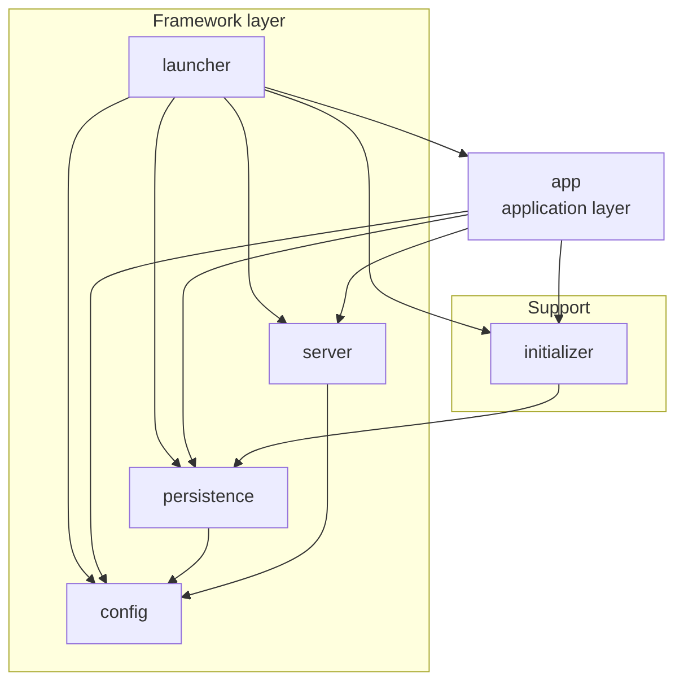
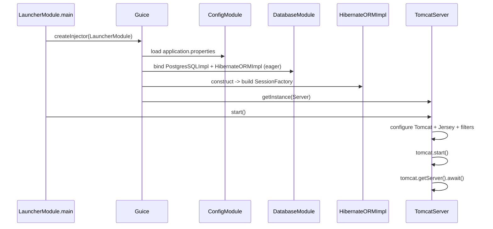
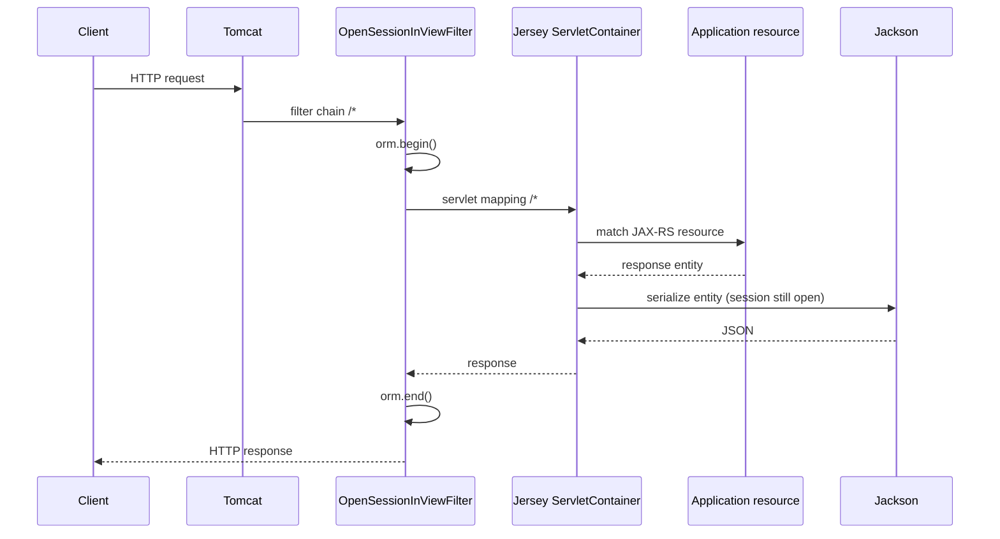

# Framework

> **In short:** The stable technical layer of Fleet Management: configuration, persistence, embedded server, generic repository support, and composition root.
>
> **Read this if:** you are working on infrastructure, reviewing the platform design, or replacing a technical implementation.
>
> **Related:** [README](../README.md) · [Application](APPLICATION.md) · [Configuration](CONFIGURATION.md) · [Development](DEVELOPMENT.md)

This document covers the **framework layer** and the **support module** used by the application. The fleet-management business code lives in the `app` module and is documented separately in [APPLICATION.md](APPLICATION.md).

---

## 1. Scope and design style

The framework is a set of Maven modules that provide technical capabilities to the application:

| Module | Role |
| --- | --- |
| `config` | Loads and exposes application properties |
| `persistence` | `Database` / `ORM` contracts, generic `BaseRepository`, PostgreSQL and Hibernate default implementations, request-scoped session filter |
| `server` | Embedded Tomcat, Jersey servlet, Guice/HK2 bridges |
| `launcher` | Composition root and application entry point |
| `initializer` | Support module for entity registration and generic repository bindings |

Design principles:

- modular monolith with build-time module boundaries;
- every technical capability is defined by a contract;
- concrete implementations are selected through Guice bindings;
- the application layer depends on contracts, not on implementation classes;
- configuration is externalized in a classpath properties file.

The framework is intentionally stable. Business features, REST resources, and entities belong to the application layer.

---

## 2. Module graph



| Module | Depends on | Responsibility |
| --- | --- | --- |
| `config` | — | Property loading and typed access |
| `persistence` | `config` | PostgreSQL, Hibernate, transactions, entity registration, request-scoped session |
| `server` | `config` | Embedded Tomcat, Jersey, Guice/HK2 bridges |
| `launcher` | `config`, `persistence`, `server`, `initializer`, `app` | Application composition root and `main` |
| `initializer` | `persistence` | Generic entity and repository registration |
| `app` | `config`, `persistence`, `server`, `initializer` | Application layer (see [APPLICATION.md](APPLICATION.md)) |

The parent POM (`com.onix322:fleet:1.0-SNAPSHOT`, packaging `pom`) declares the shared dependency versions and the Java 21 compiler configuration.

`app` declares a dependency on `server` because the application model uses JAX-RS and Jackson APIs provided by the server module. `persistence` declares `tomcat-embed-core` only for the `jakarta.servlet.Filter` API used by the request-scoped session filter.

---

## 3. Contracts

The framework exposes four public contracts:

| Contract | Package | Current implementation | Purpose |
| --- | --- | --- | --- |
| `Configuration` | `com.onix322.config` | `ConfigurationImpl` | Typed access to properties |
| `Database` | `com.onix322.persistence.database` | `PostgresSQLImpl` | `DataSource` |
| `ORM` | `com.onix322.persistence.database` | `HibernateORMImpl` | Unit-of-work scoped `EntityManager` access |
| `Server` | `com.onix322.server` | `TomcatServer` | HTTP server lifecycle |

Supporting types:

- `PostgresSQLDatabase extends Database` — PostgreSQL-specific view of the database contract.
- `HibernateORM extends ORM` — Hibernate-specific view that exposes `getSession()`.
- `LauncherModule`, `InitializerModule`, `TypeFactory`, `FilterModule`, and `OpenSessionInViewFilter`.

Each contract is bound to its implementation in a Guice module. Replacing an implementation means providing a new class and changing the binding; the application layer does not need to change.

The framework ships with **PostgreSQL** (`PostgresSQLImpl`) and **Hibernate** (`HibernateORMImpl`) as the default implementations of `Database` and `ORM`. To replace them, change the bindings in `PostgresSQLModule` or `HibernateModule`.

---

## 4. `config` module

Package: `com.onix322.config`

```text
Configuration
├── <T> T getProperty(String key, Class<T> type)
└── Properties getProperties(String key)

ConfigurationImpl
ConfigurationLoader
PropertyParser
ConfigModule
```

### ConfigurationLoader

- Reads a classpath resource, `application.properties` by default.
- Stores the result in a `java.util.Properties` instance.
- `loadProperties()` delegates to `loadProperties("application.properties")`.
- `loadProperties(String from)` fails with `IllegalStateException` if the resource is absent.
- `getRawProperty(String key)` returns the raw `String` value, or `null`.
- `getProperties()` returns the complete `Properties` object.

### PropertyParser

Converts raw strings to the requested Java type:

| Type | Behavior |
| --- | --- |
| `String` | Trimmed value; blank strings are returned as `""` |
| `Integer` | `Integer.valueOf` |
| `Long` | `Long.valueOf` |
| `Boolean` | Accepts `true` / `false` case-insensitively; other values throw `IllegalArgumentException` |
| `Double` | `Double.valueOf` |

A `null` property, or a blank property requested as a non-`String` type, produces `null`. Any other target type throws `IllegalArgumentException`.

### ConfigurationImpl

- Injected with `ConfigurationLoader` and `PropertyParser`.
- `getProperty` loads the raw value and delegates parsing.
- `getProperties` returns the complete loaded property set. The `key` argument is not used for filtering.

### ConfigModule

```java
ConfigurationLoader loader = new ConfigurationLoader();
loader.loadProperties();
Names.bindProperties(binder(), loader.getProperties());

bind(ConfigurationLoader.class).toInstance(loader);
bind(Configuration.class).to(ConfigurationImpl.class);
```

Effects:

1. `application.properties` is loaded once during injector creation.
2. Every property is bound as a Guice named constant with its raw string value.
3. The same `ConfigurationLoader` instance is available for injection.
4. `Configuration` resolves to `ConfigurationImpl`, which is annotated `@Singleton`.

Full property reference: [CONFIGURATION.md](CONFIGURATION.md).

---

## 5. `persistence` module

Package: `com.onix322.persistence`

```text
database/
├── Database
├── ORM
├── guice/DatabaseModule
├── impl/hibernate/
│   ├── HibernateORM
│   ├── guice/HibernateModule
│   └── impl/
│       ├── HibernateORMImpl
│       └── HibernateRepository
└── impl/postgresql/
    ├── PostgresSQLDatabase
    ├── guice/PostgresSQLModule
    └── impl/PostgresSQLImpl

repository/BaseRepository
filter/OpenSessionInViewFilter
filter/guice/FilterModule
guice/PersistenceModule
```

### Database and PostgresSQL

`PostgresSQLImpl` reads `database.url`, `database.user` and `database.password` through `Configuration`. `getDataSource()` creates a `PGSimpleDataSource` with the configured URL, user and password.

These three keys are general connection properties: any `Database` implementation can read them and map them to its own driver. PostgreSQL is simply the default implementation.

`Database` is a contract that exposes only the `DataSource`. `PostgresSQLDatabase` extends it for PostgreSQL-specific use, and `PostgresSQLImpl` is the current implementation. Another database can be plugged in by binding `Database` to a different implementation in `PostgresSQLModule`.

### ORM and HibernateORM

`ORM` is the transaction and session contract:

```text
ORM
├── <R> R executeWithResult(Function<EntityManager, R> action)
├── void execute(Consumer<EntityManager> action)
├── void begin()
├── void end()
└── void close()

HibernateORM extends ORM
└── Session getSession()
```

`HibernateORMImpl` is responsible for the Hibernate `SessionFactory`. It is constructed with:

- `Database` — provides the `DataSource`;
- `Configuration` — provides Hibernate settings, including the dialect;
- `Set<Class<?>> entities` — the entity classes to register.

The `SessionFactory` is built in the constructor through the private `init()` method:

```java
settings.put(AvailableSettings.JAKARTA_NON_JTA_DATASOURCE, database.getDataSource());
settings.put(AvailableSettings.DIALECT, configuration.getProperty("hibernate.dialect", String.class));
settings.put(AvailableSettings.HBM2DDL_AUTO, configuration.getProperty("hibernate.hbm2ddl.auto", String.class));
settings.put(AvailableSettings.SHOW_SQL, configuration.getProperty("hibernate.show_sql", Boolean.class));
settings.put(AvailableSettings.FORMAT_SQL, configuration.getProperty("hibernate.format_sql", Boolean.class));

entities.forEach(hibernateConfig::addAnnotatedClass);
```

Transaction helpers:

- `executeWithResult(Function<EntityManager, R>)` and `execute(Consumer<EntityManager>)` run the callback in a transaction;
- `begin()` / `end()` define the session scope (unit of work) on the current thread;
- `close()` closes the `SessionFactory` if it is still open; it is part of the contract and is not invoked automatically by the server lifecycle.

Without an active scope each call goes through `SessionFactory.fromTransaction(...)`: it opens a session, begins a transaction, runs the callback, commits on success, rolls back on failure and closes the session. Hibernate's `Session` implements `EntityManager`, so callbacks use the standard JPA API.

With an active scope the callback runs on the session bound to the current thread instead. An already active transaction is joined, matching `PROPAGATION_REQUIRED` semantics; otherwise a transaction is begun and committed around the callback. The session is closed by `end()`, not by the individual calls.

```java
orm.begin();
try {
    Van van = orm.executeWithResult(em -> em.find(Van.class, id)); // one transaction
    // ... session still open, lazy associations can be loaded ...
} finally {
    orm.end(); // rolls back a dangling transaction if needed, then closes the session
}
```

The scope is opened per HTTP request by `OpenSessionInViewFilter` in the `persistence` module (see [Request lifecycle](#10-request-lifecycle)); outside a request, such as in unit tests or background work, the short-lived behaviour applies unchanged.

### BaseRepository

Package: `com.onix322.persistence.repository`

`BaseRepository<T, ID>` is a convenience class built on the `ORM` contract. It is not a contract itself; it gives feature repositories a small, reusable CRUD base without enlarging `ORM` with CRUD operations.

| Method | Behavior |
| --- | --- |
| `Optional<T> find(ID id)` | `EntityManager.find`; rejects `null` identifiers |
| `List<T> findAll()` | Criteria query over the entity type |
| `T save(T entity)` | `EntityManager.merge` (insert or update); rejects `null` entities |
| `Boolean delete(ID id)` | `EntityManager.find` then `EntityManager.remove`; returns `false` when absent |
| `long count()` | Criteria count query |
| `boolean exists(ID id)` | `EntityManager.find` and null check |

Each method delegates to `execute` or `executeWithResult`, so every call is its own transaction. When a session scope is active (an HTTP request), all calls of the same request share one session, so entities loaded by one call stay manageable for the next ones. `save` upserts through `EntityManager.merge`.

`BaseRepository` receives `ORM` through field injection into a `protected` non-final field and keeps the entity type in a final `Class<T>` field exposed through a getter. Subclasses therefore only pass the entity type:

```java
import jakarta.inject.Singleton;

@Singleton
public class ExampleRepository<T> extends BaseRepository<T, UUID> {

    public ExampleRepository(Class<T> type) {
        super(type);
    }
}
```

`@Singleton` is `jakarta.inject.Singleton`. A generic repository needs an explicit binding per entity type; see [InitializerModule](#7-initializer-module). A concrete repository with a no-arg constructor can rely on Guice just-in-time binding.

`HibernateRepository<T, ID>` is an abstract convenience subclass of `BaseRepository`; it is available but is not used by the current application repositories.

### Entity registration

Entities are collected through a Guice multibinding of `Class<?>`:

```java
Multibinder.newSetBinder(binder(), new TypeLiteral<Class<?>>() {});
```

`HibernateModule` creates the empty set. Feature modules in the application layer add their entity classes. `HibernateORMImpl` injects the resulting `Set<Class<?>>` and registers every element with `addAnnotatedClass`.

### DatabaseModule

`DatabaseModule` installs the default implementation modules:

```java
install(new PostgresSQLModule());
install(new HibernateModule());
```

`PostgresSQLModule` binds `PostgresSQLImpl`, `Database` and `PostgresSQLDatabase` as eager singletons.

`HibernateModule` binds `HibernateORMImpl`, `ORM` and `HibernateORM` as eager singletons and creates the entity multibinder.

Both bindings are eager, so the `SessionFactory` is created during injector creation, before Tomcat starts.

### PersistenceModule and FilterModule

`PersistenceModule` is the persistence entry point used by the launcher:

```java
install(new DatabaseModule());
install(new FilterModule());
```

`FilterModule` contributes `OpenSessionInViewFilter` to the `Set<Filter>` multibinder:

```java
Multibinder.newSetBinder(binder(), Filter.class)
        .addBinding()
        .to(OpenSessionInViewFilter.class)
        .asEagerSingleton();
```

The filter belongs to the module that owns the concern: the request-scoped persistence session is a persistence concern, so both the filter and its module live under `com.onix322.persistence.filter`.

`OpenSessionInViewFilter.doFilter` calls `ORM.begin()`, runs the rest of the chain, and calls `ORM.end()` in a `finally` block. `begin()` opens the session; `end()` rolls back a dangling transaction and closes the session. Transactions remain per `ORM` call.

---

## 6. `server` module

Package: `com.onix322.server`

```text
Server
├── void start()
├── void stop()
├── void kill()
└── static void launch(Module... modules)

TomcatServer
GuiceToHK2Bridge
Hk2IntoGuiceBridge
Hk2LocatorHolder
ServerModule
```

### Server

`Server.launch(Module... modules)` is the bootstrap helper:

1. creates the Guice injector from the supplied modules;
2. obtains the `Server` instance;
3. calls `start()`;
4. on failure, calls `kill()` and rethrows as `RuntimeException`.

### TomcatServer

Constructor-injected fields:

- `Tomcat` — the embedded container;
- `Configuration` — server settings;
- `Injector` — passed to the Jersey bridge;
- `Hk2LocatorHolder` — filled by Jersey when the servlet starts;
- `Set<Filter>` — servlet filters contributed through Guice.

`start()`:

1. calls `tomcatConfig(tomcat)`;
2. creates the default connector with `tomcat.getConnector()`;
3. starts Tomcat;
4. blocks the calling thread with `tomcat.getServer().await()`.

`stop()` stops Tomcat. `kill()` stops and destroys it.

`tomcatConfig(Tomcat)`:

- reads `server.port`, `server.base.dir`, `server.context.path`;
- uses `8080` when the port is `null` or `0`;
- uses `System.getProperty("java.io.tmpdir")` when the base directory is blank;
- sets `docBase` to `null` when the base directory is blank;
- adds the context with `addContext(contextPath, docBase)`;
- configures Jersey;
- registers the Guice-provided filters.

`jerseyConfig(Context)`:

- creates a Jersey `ResourceConfig`;
- scans the `com.onix322.app` package for JAX-RS components;
- registers `GuiceToHK2Bridge` with the application injector and the locator holder;
- creates a `ServletContainer` and registers it as the `jersey` servlet;
- sets `loadOnStartup(1)`;
- maps the servlet to `server.api.path` (`/*` by default).

`filtersConfig(Context)` registers every `Filter` from the injected `Set<Filter>` with a `FilterDef` and a `FilterMap` on `/*`. The filter name is the filter class name. Filters wrap the Jersey servlet, so they cover the whole request — including the Jackson serialization that happens after the resource method returns. This is how `OpenSessionInViewFilter` is installed without the `server` module depending on `persistence`.

### Guice/HK2 bridges

Jersey uses HK2 internally, the application uses Guice, so both directions are bridged.

**Guice → HK2.** `GuiceToHK2Bridge`, a JAX-RS `Feature`, connects the Jersey `ServiceLocator` to the Guice injector:

```java
GuiceBridge.getGuiceBridge().initializeGuiceBridge(serviceLocator);
GuiceIntoHK2Bridge bridge = serviceLocator.getService(GuiceIntoHK2Bridge.class);
bridge.bridgeGuiceInjector(injector);

locatorHolder.set(serviceLocator);
```

This lets Jersey-resolved components use Guice-managed dependencies, including `ORM`, `Configuration` and `Database`.

**HK2 → Guice.** `Hk2IntoGuiceBridge`, installed by `ServerModule`, creates and binds `Hk2LocatorHolder` and registers a Guice `TypeListener` for fields annotated with `@HK2Inject`:

```java
@HK2Inject
private UriInfo uriInfo;
```

The stock `HK2IntoGuiceBridge` module cannot be used directly: it needs the `ServiceLocator` when the injector is created, while Jersey creates that locator only when the servlet starts. The listener therefore reads the locator from `Hk2LocatorHolder`, filled by `GuiceToHK2Bridge` the first time Jersey initializes. Consequences:

- only field injection works (no constructor or parameter injection for HK2 services);
- a Guice object created before Jersey starts cannot resolve `@HK2Inject` fields;
- the locator is Jersey's own, so request-scoped services such as `UriInfo` resolve per request.

### ServerModule

Binds `Server` to `TomcatServer`, installs `Hk2IntoGuiceBridge`, and creates the servlet filter multibinding:

```java
bind(Server.class).to(TomcatServer.class);
install(new Hk2IntoGuiceBridge());

Multibinder.newSetBinder(binder(), Filter.class);
```

Modules that own a filter add it to that set; `TomcatServer` registers everything it receives. The empty multibinder keeps `Set<Filter>` injectable when no filter is contributed.

Because the module binds the `Server` contract, the container is replaceable. `Server.launch` and the rest of the application depend only on the interface.

The `Tomcat` instance itself has no explicit binding. Guice creates it through just-in-time binding because `org.apache.catalina.startup.Tomcat` is a concrete class with a no-argument constructor.

---

## 7. `initializer` module

Package: `onix322.initializer` (the package currently has no `com.onix322` prefix in the codebase).

```text
onix322.initializer
├── TypeFactory
└── guice/InitializerModule
```

`InitializerModule` registers a set of entity classes and binds one generic repository implementation per entity:

```java
public class InitializerModule extends AbstractModule {

    private final Set<Class<?>> entities;
    private final Class<?> repository;

    public InitializerModule(Set<Class<?>> entities, Class<?> repository) {
        this.entities = entities;
        this.repository = repository;
    }

    @Override
    protected void configure() {
        Multibinder<Class<?>> set =
                Multibinder.newSetBinder(binder(), new TypeLiteral<Class<?>>() {});
        entities.forEach(entity -> set.addBinding().toInstance(entity));

        Provider<TypeFactory> factory = getProvider(TypeFactory.class);
        entities.forEach(entity -> register(entity, factory));
    }

    private void register(Class<?> entity, Provider<TypeFactory> factory) {
        TypeLiteral key = TypeLiteral.get(Types.newParameterizedType(repository, entity));
        bind(key).toProvider(() -> factory.get().create(entity, key)).in(Singleton.class);
    }
}
```

`TypeFactory` creates the repository reflectively:

```java
public <T, R extends BaseRepository<T, UUID>> R create(
        Class<T> entityClass,
        TypeLiteral<R> repositoryClass
) {
    Class<R> rawType = (Class<R>) repositoryClass.getRawType();
    Constructor<R> constructor = rawType.getDeclaredConstructor(Class.class);
    constructor.setAccessible(true);
    R repository = constructor.newInstance(entityClass);
    injector.injectMembers(repository);
    return repository;
}
```

This is required because a generic repository such as `VehicleRepository<T>` cannot be resolved by Guice from its erased type alone. `InitializerModule` creates the concrete `VehicleRepository<Van>` binding from the entity set.

The module is not installed globally by `LauncherModule`. Each feature module that uses generic repositories installs it:

```java
install(new InitializerModule(VEHICLE_ENTITIES, VehicleRepository.class));
```

Feature modules that only register entities use the multibinder directly. `ReportModule` currently performs the same entity and repository binding inline with `TypeFactory`.

---

## 8. `launcher` module

Package: `com.onix322.launcher`

`LauncherModule` is the application composition root and contains the entry point:

```java
public class LauncherModule extends AbstractModule {

    @Override
    protected void configure() {
        install(new ServerModule());
        install(new ConfigModule());
        install(new PersistenceModule());
        install(new AppModule());
    }

    public static void main(String[] args) {
        Server.launch(new LauncherModule());
    }
}
```

`AppModule`, in the application layer, installs the feature modules. `LauncherModule` does not install `InitializerModule`; feature modules do that themselves.

---

## 9. Startup sequence



Step by step:

1. `LauncherModule.main` calls `Server.launch(new LauncherModule())`.
2. Guice creates an injector from `LauncherModule`.
3. `ConfigModule` loads `application.properties` from the classpath and binds every property as a named constant.
4. `PersistenceModule` installs `DatabaseModule` and `FilterModule`.
5. `DatabaseModule` installs `PostgresSQLModule` and `HibernateModule`; both bind eager singletons and create the entity multibinder.
6. `AppModule` installs the feature modules; feature modules add entities and generic repository bindings.
7. Guice constructs `PostgresSQLImpl`, then `HibernateORMImpl`. The `SessionFactory` is built and connects to PostgreSQL according to the configured JDBC URL. With `hibernate.hbm2ddl.auto=create-drop`, Hibernate drops and recreates the schema at this point.
8. Guice resolves `Server` to `TomcatServer`. `Tomcat` is created through just-in-time binding; `Configuration`, `Injector`, `Hk2LocatorHolder` and `Set<Filter>` are injected.
9. `server.start()` configures Tomcat, Jersey and the filters, opens the connector, starts the container and blocks on `await()`.
10. The process stays alive until the JVM exits or the server is stopped programmatically.

If `start()` throws, `Server.launch` calls `server.kill()` and wraps the exception in a `RuntimeException`. Failures during injector creation or `getInstance(Server.class)` occur before that try block and propagate directly.

---

## 10. Request lifecycle



Step by step:

1. The client connects to the Tomcat connector on `server.port` (default `8080`).
2. The request enters the configured context (`server.context.path`, root by default).
3. `OpenSessionInViewFilter`, contributed by `FilterModule` from the `persistence` module, opens the session scope with `ORM.begin()`.
4. Tomcat routes the request to the `jersey` servlet because `server.api.path` is `/*`.
5. Jersey scans `com.onix322.app` for JAX-RS components and matches the request against an application resource.
6. The resource executes and returns an entity or a `Response`.
7. Jersey uses the Jackson JSON provider (`jersey-media-json-jackson`) to serialize the result. The session is still bound to the thread, so lazy associations are loaded on demand instead of throwing `LazyInitializationException`.
8. The response is returned with the media type declared by the resource.
9. The filter closes the scope with `ORM.end()` in a `finally` block, which also rolls back a transaction left open by a failed request.

Unregistered paths are handled by Jersey and produce a `404`. Without a custom exception mapper, the response uses the servlet container's default error page.

---

## 11. Dependency injection

The application uses two containers:

| Container | Scope | Role |
| --- | --- | --- |
| Guice | Application | Singletons, configuration, database, server, feature bindings |
| HK2 | Jersey internals | Resource discovery and JAX-RS component lifecycle |

`GuiceToHK2Bridge` and `Hk2IntoGuiceBridge` connect them in both directions. Guice remains the source of truth for application services; HK2 delegates resolution to Guice for components that need injected dependencies, and Guice objects can resolve HK2 services through `@HK2Inject` fields.

The two containers do not treat injection annotations identically:

| Component | Created by | Constructor annotation |
| --- | --- | --- |
| JAX-RS resource | Jersey / HK2 | `jakarta.inject.Inject` |
| Service | Guice | `jakarta.inject.Inject` |
| Repository | Guice | `jakarta.inject.Inject` |

HK2 selects resource constructors by looking for `jakarta.inject.Inject`. `com.google.inject.Inject` is ignored there, so a resource annotated only with the Guice annotation fails with `NoSuchMethodException: Could not find a suitable constructor`. Guice 7 accepts the Jakarta annotation too, so `jakarta.inject.Inject` is the single annotation used across the project.

Guice bindings are only required for interfaces, qualifiers, providers, and explicit implementation choices. Concrete classes annotated with `@Singleton` and an injectable constructor receive a just-in-time binding and do not need an explicit `bind(...)`. Generic repositories are the exception: their type parameters are erased, so they are bound explicitly by `InitializerModule` or an equivalent provider. JAX-RS resources are created by Jersey, not Guice, so binding them in a Guice module has no effect.

Injection style in the project:

- constructor injection;
- Lombok `@AllArgsConstructor(onConstructor_ = @Inject)` or `@RequiredArgsConstructor(onConstructor_ = @Inject)` for concise constructors;
- field injection only where a constructor cannot express the dependency, such as the generic `BaseRepository` and `@HK2Inject` fields;
- interface-to-implementation bindings in Guice modules.

Prefer the Jakarta annotations (`jakarta.inject.Inject`, `jakarta.inject.Singleton`, `jakarta.inject.Named`, `jakarta.inject.Qualifier`) over their Guice equivalents. Guice 7 supports the Jakarta API, and HK2 supports it for resources, so one annotation set works across both containers. Keep Guice annotations only where Jakarta has no equivalent: `@Provides`, `@ImplementedBy`, `@ProvidedBy`, optional `@Inject`, and Guice-specific scopes.

### Jakarta annotations in use

| Annotation | Applied to | Where it is used |
| --- | --- | --- |
| `jakarta.inject.Inject` | constructor or field | framework implementation constructors, `TypeFactory`, application services and resources, the `orm` field of `BaseRepository` |
| `jakarta.inject.Singleton` | concrete class | `ConfigurationLoader`, `PropertyParser`, `ConfigurationImpl`, `PostgresSQLImpl`, `HibernateORMImpl`, `TomcatServer`, modules, repositories, services |
| `jakarta.inject.Named` | constructor parameter or field | a dependency that consumes a named property binding, for example `@Named("server.port")` |
| `jakarta.inject.Qualifier` | custom annotation | user-defined qualifiers used to select between alternative implementations |

Lombok generates the constructor, so the annotation is passed through `onConstructor_`:

```java
@Singleton
@AllArgsConstructor(onConstructor_ = @Inject)
public class SomeService {

    private final Configuration configuration;
}
```

`@RequiredArgsConstructor` works the same way and includes only `final` fields. Field injection is reserved for cases a constructor cannot express, such as the generic `BaseRepository`, whose subclasses supply the entity type:

```java
public abstract class BaseRepository<T, ID> {

    @Inject
    protected ORM orm;
    // ...
}
```

Guice annotations remain only where the injector itself is configured: `AbstractModule`, `bind(...)`, `@Provides` / `@ProvidesIntoSet`, `Multibinder`, `MapBinder`, `TypeLiteral`, `Injector`, and `Names.bindProperties`.

`ConfigModule` also exposes every property as a named binding. `Names.bindProperties` binds the raw string values, so a dependency can be written as:

```java
@Inject
public SomeService(@Named("server.port") String port) {
    // ...
}
```

Typed access is provided by `Configuration`, which parses the raw values.

---

## 12. Persistence model

### Entity discovery

```text
HibernateModule      ──creates──►  Multibinder<Class<?>>
Application modules  ──adds─────►  entity classes
HibernateORMImpl     ──injects──►  Set<Class<?>>
```

`HibernateORMImpl` registers every class in the set with Hibernate's `Configuration.addAnnotatedClass`. New entities become visible to Hibernate when an application feature module adds them to the set, either directly or through `InitializerModule`.

### Schema management

The schema strategy is controlled by `hibernate.hbm2ddl.auto`, currently `create-drop` in `config/src/main/resources/application.properties`. Hibernate drops and recreates tables to match the mapped entities during `SessionFactory` creation. This destroys existing data on every startup; use another strategy for environments where data must survive restarts.

### Transaction boundary

The `ORM` contract is the transaction boundary:

```java
// Read or write with a return value
List<Entity> entities = orm.executeWithResult(em ->
    em.createQuery("select e from Entity e", Entity.class).getResultList()
);

// Write without a return value
orm.execute(em -> em.persist(entity));
```

Each call runs in its own transaction. A unit of work spans multiple calls only through `begin()` / `end()`, which share the session, not the transaction. This is what makes lazy loading inside a response work: the session stays open until the request ends, while each `ORM` call still commits or rolls back on its own.

The application opens the scope per HTTP request through `OpenSessionInViewFilter`, contributed by `FilterModule` and registered as a servlet filter by `TomcatServer`. Outside a request (`begin()` not called), behaviour is unchanged: session and transaction are opened and closed per call.

---

## 13. Extension points

### Add a framework module

1. Create a Maven module that depends on `config` when it needs configuration.
2. Create an `AbstractModule` that binds its contracts.
3. Install the module from `LauncherModule`.
4. Add the module to the parent `pom.xml`.

The application layer does not need to change unless it uses the new contract.

### Replace a technical implementation

The technical contracts are `Database`, `ORM` and `Server`. To replace one:

1. implement the contract;
2. change the binding in the relevant Guice module (`PostgresSQLModule`, `HibernateModule` or `ServerModule`);
3. keep the startup path and application code unchanged.

For example, replacing Tomcat requires a new `Server` implementation and a different binding in `ServerModule`; `Server.launch(...)` remains the same.

### Plug in application features

Application feature modules register their entities and services through Guice modules. The framework discovers entities through the `Set<Class<?>>` multibinding and discovers REST resources through the Jersey package scan. Generic repositories additionally use `InitializerModule` or a local `TypeFactory` provider binding.

See [APPLICATION.md](APPLICATION.md) for the application implementation model.

### Add a configuration key

1. add the key to `application.properties`;
2. read it through `Configuration.getProperty(key, type)`;
3. document it in [CONFIGURATION.md](CONFIGURATION.md).

---

## 14. Versions

Dependency versions are declared in the parent [`pom.xml`](../pom.xml). The `guice-bridge` version is declared in [`server/pom.xml`](../server/pom.xml).

The framework targets Java 21 and uses:

- Apache Tomcat (embedded);
- Jersey (JAX-RS) with HK2;
- Google Guice;
- Hibernate ORM with Jakarta Persistence;
- PostgreSQL JDBC driver;
- Jackson;
- SLF4J and Logback;
- Lombok for boilerplate reduction.

Exact coordinates and versions are maintained in Maven, not duplicated in this document.

---

## 15. Runtime topology

```text
┌──────────────────────────────────────────────┐
│ JVM (Java 21)                                │
│                                              │
│  LauncherModule.main                        │
│    └── Guice injector                        │
│          ├── Configuration                    │
│          ├── PostgresSQLImpl DataSource       │
│          ├── HibernateORMImpl SessionFactory  │
│          ├── OpenSessionInViewFilter          │
│          └── TomcatServer                     │
│                └── embedded Tomcat :8080      │
│                      └── Jersey servlet /*    │
│                            └── JAX-RS         │
└──────────────────────┬───────────────────────┘
                       │ JDBC
                       ▼
              PostgreSQL :5432
```

The framework runs in a single JVM process with a single outbound dependency: the PostgreSQL database.

---

## 16. Summary

- **Framework layer:** `config`, `persistence`, `server`, `launcher`.
- **Support module:** `initializer`, used for generic entity/repository registration.
- **Contracts:** `Configuration`, `Database`, `ORM`, `Server`.
- **Dependency direction:** framework modules depend on `config`; the application depends on framework contracts.
- **Server:** embedded Tomcat + Jersey, started programmatically from `LauncherModule.main`.
- **DI:** Guice for application services, HK2 for Jersey internals, bridge between them in both directions.
- **Persistence:** Hibernate `SessionFactory` built eagerly from a PostgreSQL `DataSource`; entities registered through a Guice multibinder.
- **Transactions:** callback-based `ORM` API, one transaction per call, plus a per-request session scope (`begin()` / `end()`) that keeps lazy loading alive during serialization.
- **Configuration:** classpath `application.properties`, typed access through `Configuration`, named Guice bindings for every property.
